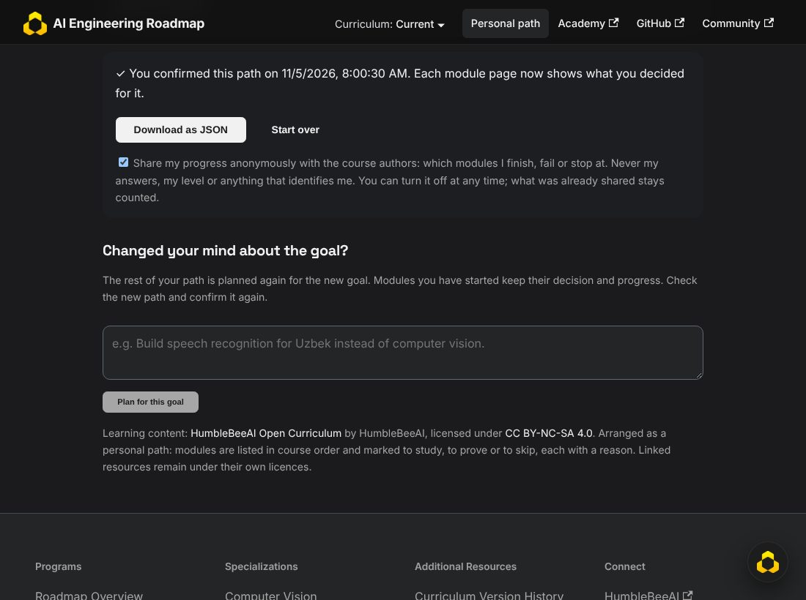

# Personalized Learning Roadmap

> Everyone gets the same learning path, most people abandon it, and nobody finds out whether anything was learned.

An AI system that builds a **personal path through a real technical curriculum**, the HumbleBeeAI Open
Curriculum ([roadmap.humblebee.ai](https://roadmap.humblebee.ai)). It suggests the learner's level from
open-ended answers and explains why, marks every module to study, prove or skip with a reason, and checks
understanding with a checkpoint before the learner moves on.

Capstone project **S2** — Convergence of Business Administration & Engineering Capstone Design,
Inha University (IBT / ISE), Fall 2026, in partnership with HumbleBeeAI.

**Status (5 November 2026).** Baseline and the code of the Target are built: the learner uses a page on the
curriculum site, backed by an HTTP API. Not done yet: testing with five real learners, the business case,
review of the checkpoint questions by someone who knows each topic, and runs of the new features with a real
model. Two Stretch items are built early: goal change mid-path and the report on where learners stop.

## Documents

| Document | Contents |
|---|---|
| [docs/project-overview.md](docs/project-overview.md) | Problem, buyer, why AI, plan, Baseline/Target/Stretch, data, tools, hard parts |
| [docs/architecture.md](docs/architecture.md) | C4 Level 1 and Level 2 diagrams and the decisions behind them |
| [docs/data-sources.md](docs/data-sources.md) | The curriculum, the model, the data learners share, and their limits |
| [docs/test-plan.md](docs/test-plan.md) | Each Baseline and Target item, the test that checks it and its status |
| [docs/learner-testing.md](docs/learner-testing.md) | How we test with real learners and write it up |
| [docs/questions.md](docs/questions.md) | Open questions and what was decided |
| [docs/team-rnr.md](docs/team-rnr.md) | Roles, what each member owns, reviewers |
| [docs/ground-rules.md](docs/ground-rules.md) | How the team meets, reviews code and handles data |
| [checkpoints/README.md](checkpoints/README.md) | How checkpoints are generated and reviewed |
| [deploy/README.md](deploy/README.md) | Running the site and the API on one server |

## The problem

Free technical learning material is abundant; completion is not. A fixed path fails in two directions at
once: experienced learners quit out of boredom because the early material repeats what they know and there
is no way to say so, and beginners quit out of overwhelm because they reach material assuming knowledge
nobody checked they had. Nothing verifies that a section was understood, so learners advance on the feeling
of having read something.

**Buyer:** a learning platform or content publisher with a completion problem. They can see where learners
drop out and cannot fix it, because the content is fixed and the audience is not. Value is measured directly
in completion and retention.

## How it works

1. **Onboarding.** Six open questions about what the learner has done and what they want to do. A demo can
   start from one of three invented learners instead.
2. **Level.** A model suggests beginner, intermediate or advanced, with the evidence from the answers and how
   sure it is. The learner can choose another level; the path is planned for the one they choose.
3. **Path.** Every module of the curriculum, in course order, marked *study*, *prove* or *skip* with a reason.
   *Prove* is offered only for modules that state what finishes them: the learner shows they can do it instead
   of studying the module. The learner can change any decision and confirms the path before using it.
4. **Checkpoints.** On a module's page, five multiple-choice questions; four right answers pass. Modules that
   teach programming then give a coding problem, run in the learner's browser against tests. A failed
   checkpoint locks the modules after it until a retake passes, and turns *prove* into *study*.
5. **Adaptation.** A checkpoint passed without a mistake at the first try asks the model whether later modules
   can be lightened; the learner accepts or declines each suggestion. A learner who changes their goal gets
   the rest of the path planned again, keeping what they have started.

A learner who creates an account (with Google, or with an email and a password) keeps their path and progress on our server, so the
rules of the path hold there and not only in the page. A path planned before signing up is kept for a day,
so the learner can look at it first and keep it by signing up. The path can be downloaded as JSON, and the
account deleted with everything in it.

## Architecture

Starter template: [module-python-template](https://github.com/humblebeeai/module-python-template). The core is
a Python library with a command line. A small HTTP API (FastAPI) puts it behind the curriculum site, because
the site is static and cannot hold the model keys. The only database is a SQLite file for the progress events
learners choose to share.

From the template we took the project layout, the packaging setup and the automatic checks, which run before
each commit and again on every pull request. Our changes: Python 3.11, the pull-request checks also run the
tests, and markdownlint is off because its fixes would rewrite documents the whole team edits. Left out:
PyPI publishing, release automation and the MkDocs site — we publish no package.

C4 Level 1 and Level 2 diagrams: [docs/architecture.md](docs/architecture.md).

| Path | Contents |
|---|---|
| `src/roadmap/` | The core and its command line: curriculum parser, level, planner, checkpoints, progress rules, HTTP API |
| `src/roadmap/prompts/` | Model instructions as Markdown, editable without touching code |
| `config/` | Curriculum versions and attribution, onboarding questions, invented example learners, models |
| `checkpoints/` | Checkpoint questions and coding problems, one file per module and curriculum version |
| `deploy/` | Docker Compose for the site, the API and HTTPS on one server |
| `tests/` | Tests; the model is replaced by a stub, the curriculum by a small invented course |

The learner's page — questions, path, checkpoints on module pages — is React code in the curriculum site
(Docusaurus), in our fork of HumbleBeeAI's repository, under `src/components/personal-path/`.

The model makes the judgement calls: the level, what to do with each module, and suggestions after a
checkpoint. Code keeps the course order, checks that every module got a decision, grades checkpoints, applies
the locks and adds the attribution, so a path never contains a link the model made up.

## Content source, licence and attribution

| | |
|---|---|
| Dataset | HumbleBeeAI Open Curriculum |
| Source | https://roadmap.humblebee.ai · repository https://github.com/humblebeeai/int.academy-curriculum |
| Licence | **CC BY-NC-SA 4.0** — attribution required, share-alike applies to derivatives, non-commercial |
| Versions | New paths: the current curriculum, commit [`9fc5573`](https://github.com/humblebeeai/int.academy-curriculum/commit/9fc5573ddbd7be5d5da997a26c49afeafbfe6210) (22 October 2026), 20 modules. Still served: commit [`5c21272`](https://github.com/humblebeeai/int.academy-curriculum/commit/5c212720af50ffd0a1592ea6c0f812c3af733ed3) (7 September 2026), 18 modules, the site's "October 6, 2026" version and the one our model runs of 21 October used |
| Personal data | None in the source content |
| Preprocessing | MDX parsed into modules with their resources, prerequisites, topics, completion criteria and workload |

Learning content is © HumbleBeeAI, used under CC BY-NC-SA 4.0. Every module in a path carries its title and
URL, and the path carries the licence; the page shows the attribution under every path.

### How we comply

A path orders the curriculum's modules and includes their titles, descriptions, topics and completion
criteria; checkpoint questions are written from the same material. Whether that makes them adaptations is open
(Q-001), so we license them under CC BY-NC-SA 4.0, which is safe under either reading. We do not sell the
tool, charge for access, or ship the content into a commercial product.

**This repository is licensed in two parts:** source code under **MIT** (matching the starter template), and
documentation plus anything derived from the curriculum, such as paths and checkpoints, under
**CC BY-NC-SA 4.0**. Share-alike follows the content into its adaptations, but not into independent software
that reads it. The curriculum is not copied into this repository; it is fetched from its own repository at
pinned versions. The personal path page lives in the curriculum's own repository and takes that repository's
licence.

The source states its licence inconsistently: `LICENSE`, its README and the licensing section of
`CONTRIBUTING.md` say CC BY-NC-SA 4.0, while one line of `CONTRIBUTING.md` and both `llms.txt` files say
CC BY-SA 4.0, without the non-commercial term. We follow the stricter reading, which is also what the
project brief states. Whether a path counts as an adaptation is Q-001 in [docs/questions.md](docs/questions.md),
pending confirmation by the professors; attribution applies either way.

The resources the curriculum links to (175 in the current version) stay under their own licences — we link
to them and keep their metadata, and do not copy their content.

## Learner data

The answers a learner types go to our API and to the model provider. With an account, we keep the learner's
email (verified by Google, or not verified), a scrypt hash of their password if they chose one, Google's id
for them if they signed in with Google, their path and their onboarding answers until they delete the
account; a path planned without an account is deleted after a day. A learner can choose to share anonymous progress (which modules they finish, fail or stop
at); nothing else about them is kept. Data from testing with real learners is kept to the minimum, participants
are told what is collected, and **no learner data is published in this repository**. Details:
[docs/data-sources.md](docs/data-sources.md).

## Setup

Python 3.11 or newer and Git. From the repository root:

```bash
python -m venv .venv
```

Activate it (`.venv\Scripts\activate` on Windows, `source .venv/bin/activate` elsewhere), then:

```bash
pip install -e ".[api,test,dev]"
```

```bash
pre-commit install
```

```bash
python -m roadmap fetch
```

`pre-commit install` turns the checks on: a commit that contains a key or a password is stopped, code is
formatted, and commits straight to `main` are refused. Files uploaded through the GitHub website skip these
checks; the pull request runs them.

To personalize paths, copy `.env.example` to `.env` and add `LLM_API_KEY_GROQ` or `LLM_API_KEY_GOOGLE`.
`LLM_PROVIDER` chooses one; otherwise the first provider in [config/llm.yaml](config/llm.yaml) with a key is
used. Without a key everything still runs, but paths follow the course as written.

### Run the page locally

The API, from this repository:

```bash
uvicorn roadmap.api:app --app-dir src --port 8000
```

The site, from our fork of the curriculum repository (needs Node.js 20 or newer):

```bash
npm ci
```

```bash
PERSONAL_PATH_API=http://localhost:8000 npm start
```

Then open http://localhost:3000/personal-path. On a server, use [deploy/](deploy/README.md) instead.

### Command line

| Command | What it does |
|---|---|
| `python -m roadmap fetch` | Checks out every curriculum version in `config/curriculum.yaml` |
| `python -m roadmap plan p1` | The path for example learner P1 in the terminal; `--level advanced` overrides the level, `--out p1.json` saves the JSON |
| `python -m roadmap compare` | Paths for all example learners and how much each pair differs |
| `python -m roadmap checkpoints <module id>` | A draft checkpoint written by the model, to be reviewed; `--all` for every module, `--verify` runs the coding problems' reference solutions |
| `python -m roadmap report` | Where learners who share their progress stop, per module |
| `pytest` | The tests |

`plan`, `compare`, `checkpoints` and `report` take `--curriculum 2026-10-06` for the older version; `plan`,
`compare` and `checkpoints` take `--provider google` to switch provider for one run, and `--verbose` to log the
time and tokens of every model call.

### The HTTP API

| Endpoint | What it does |
|---|---|
| `GET /questions`, `GET /profiles` | The onboarding questions and curriculum versions; the invented example learners |
| `POST /level`, `POST /path` | A suggested level; a path for the level the learner chose |
| `POST /path/confirm`, `POST /path/goal` | Confirm a path; plan the rest of it for a new goal |
| `GET /checkpoints`, `GET /checkpoints/{module}` | Which modules have a checkpoint; an attempt's questions, without answers |
| `POST /attempts/{module}` | Grade an attempt and return the path with its result |
| `GET /problems/{module}`, `POST /problems/{module}/solved` | A coding problem without its solution; record that the learner's code passed |
| `POST /path/done`, `/path/accept`, `/path/decline` | Mark a module without a checkpoint done; answer a suggestion |
| `GET /report` | Where learners who share their progress stop; needs `API_REPORT_TOKEN` |

Settings (environment or `.env`): `API_ALLOWED_ORIGINS` lists the sites that may call the API (default
`http://localhost:3000`); `API_RATE_LIMIT` and `API_RATE_WINDOW` limit model calls per client (default 20 an
hour) to share the free-tier quota, in memory, so for one server process; `API_REPORT_TOKEN` opens the report;
`API_EVENTS_FILE` says where shared progress is kept (default `data/events.sqlite`).

## Curriculum versions

`python -m roadmap fetch` clones the curriculum once into `data/curricula/repository/` (git-ignored) and checks
out every version in [config/curriculum.yaml](config/curriculum.yaml) next to it. The repository is public and
needs no credentials.

New paths use the first version, the current curriculum. A path planned for another listed version keeps
working against that version and links to its pages on the site, so learners keep their progress when the
course changes. The current curriculum hides retired modules (`unlisted` pages, which we leave out) and states
what finishes a module under "Expected output", "What you'll build" and "Finish this module" instead of tick
boxes; `completion_headings: true` reads those. The October 6 version is read exactly as before, so the model
runs of 21 October can be repeated:

```bash
python -m roadmap compare --curriculum 2026-10-06
```

## Checkpoints

Questions are written once per module and curriculum version, reviewed by a person, and kept in `checkpoints/`;
learners do not wait for a model, and grading is code. An attempt shows five questions with the options in a new
order; the right answers appear only after a pass, and a failed attempt names the module topics to review. The
next attempt shows the next five questions. The coding problem, where there is one, runs in the learner's
browser with Pyodide; the server cannot run a learner's code safely, so it takes the browser's word that the
tests passed.

A capstone has no checkpoint: the learner submits their project, as a link, a .zip or .tar.gz archive of up to
20 MB, or both, and a reviewer (`API_REVIEWER_EMAILS`) accepts it or sends it back with a comment on the
site's `/review` page. The server never fetches the link and never unpacks or runs the archive: it checks that
the file starts like a zip or gzip file, keeps it under a random name, and hands it only to its learner and to
reviewers, as a download.

The path lives on the server, so a learner cannot undo a lock or replay an old attempt: each attempt must
follow the one the server stored. The coding problem is the exception: it counts as solved on the browser's
word. See [checkpoints/README.md](checkpoints/README.md) for how
checkpoints are made.

The checkpoints in `checkpoints/` are drafts, none reviewed yet. Terminal & Algorithmic Basics and Data
Foundations were written by Claude during development so that the flow can be shown; Math for AI and
Software Engineering for AI (current version) are `roadmap checkpoints` output, generated with OpenAI
`gpt-6-luna` while testing the generator.

## Fallback when the model is unavailable or rate-limited

If a model is rate-limited, down, or gives a plan that leaves a module out, the next model listed for the
provider in [config/llm.yaml](config/llm.yaml) is tried; free-tier quotas are counted per model. If no model
answers, the path is the whole course in its own order and the learner is told that personalization is
unavailable. Nothing is skipped without a model: a wrong skip does more harm than repeating familiar material.
Without a model, checkpoints still work, there are no suggestions after them, and a goal change is refused
with the path left as it was. Gemini comes first; Groq is used when `LLM_PROVIDER=groq` or there is no Google
key (Q-003).

## Example output

The page on the curriculum site, run locally on 5 November without a model key: the path is therefore the
fallback (every module to study), while checkpoints, the coding problem and progress work as with a model.

| | |
|---|---|
|  |  |
| The questions, filled in from invented learner P1 | The confirmed path: the goal, the next module, the counts and the hours |
|  |  |
| A failed attempt: wrong answers marked, right answers hidden, topics to review | The coding problem after the questions, its tests passed in the browser |
|  | |
| The choice to share progress, the goal change, and the attribution | |

## Test results, known errors and limitations

`pytest` checks everything code decides — parsing both curriculum versions, course order, attribution, the
fallback, checkpoint grading, locks, suggestions, goal change and the report — with a stub in place of the
model. Eight tests run on the real curriculum and are skipped until `python -m roadmap fetch` has run. The
page was checked in a browser at desktop and phone width on 5 November: questions, path, a failed and a
passed checkpoint, the coding problem, sharing and goal change.

Model runs on 21 October, on the October 6 version, 3–5 per profile and model
([report](docs/test-results/2026-10-21-model-stability.md)). With `gemini-3.5-flash-lite`, 93% of decisions
stayed the same across runs and 96% matched the [expected decisions](docs/test-results/expected-decisions.md);
the paths of P1 and P2 differ by 40–50%. Its one repeated error: P1, who has never used NumPy or Pandas, is
asked to prove the module that teaches them.

Not tested yet:

- the current curriculum with a real model: the expected decisions are written for the 18 modules of the
  October 6 version and need redoing for the 20 of the current one;
- checkpoint generation, suggestions after a checkpoint and goal change with a real model;
- the Docker setup on a server;
- the level suggestion against what real learners say about themselves, and every other learner test (Target).

## Team

| Name | Role |
|---|---|
| Li Mikhail | PM, AI / Engineering |
| Abdulkhaev Akbarjon | Problem & Business |
| Jalilov Jakhongir Zukhriddin ugli | Data & Research |
| Chagai Vladimir | AI / Engineering |
| Imetov Daniiar | Demo & Presentation |

Umaraliev Makhmudjon, our first project manager, is on academic leave. Student IDs, what each person is
responsible for and who reviews their work are in the role sheet:
[docs/team-rnr.md](docs/team-rnr.md).

## Use of AI tools

Claude (Anthropic) was used throughout:

- **Documents.** A substantial part of the documentation was drafted with Claude and edited rather than taken
  as it came. We checked the Baseline, Target and Stretch items against the S2 project brief, the licence in
  the source repository's own files, and the content statistics, which come from parsing the source repository
  rather than from a model.
- **Code.** The core, the HTTP API, the checkpoints and progress rules, the curriculum versions, the personal
  path page on the curriculum site and `deploy/` were written with Claude. The tests were run, the module URLs
  were checked against the curriculum site's sitemap, and the page was checked in a browser.
- **Data.** The expected decisions in `docs/test-results/` and the draft checkpoints in `checkpoints/` were
  drafted by Claude. The checkpoints still need review by someone who knows each topic.
