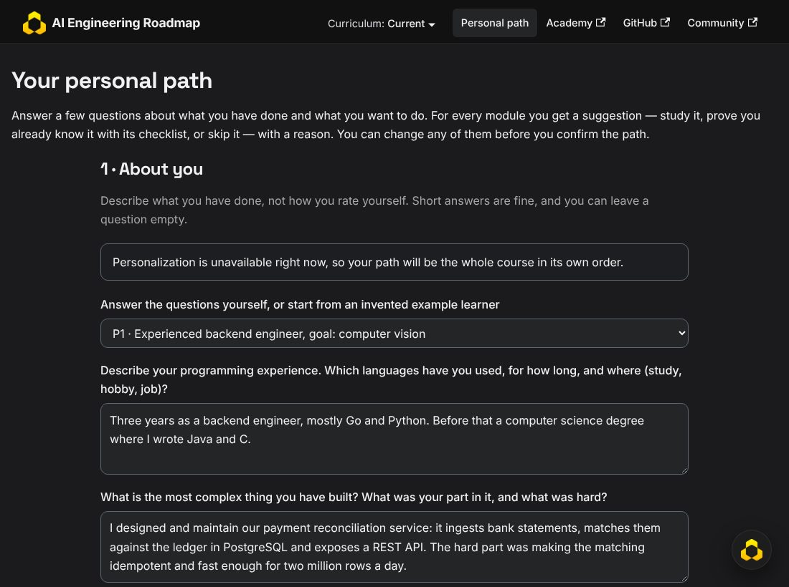
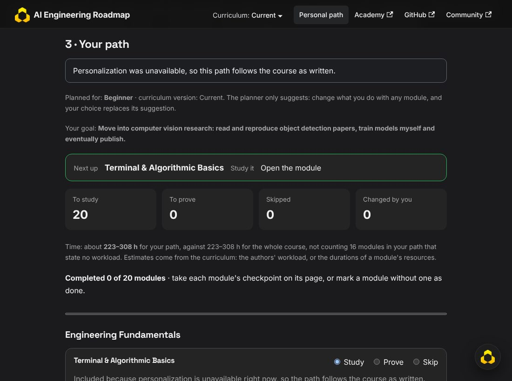
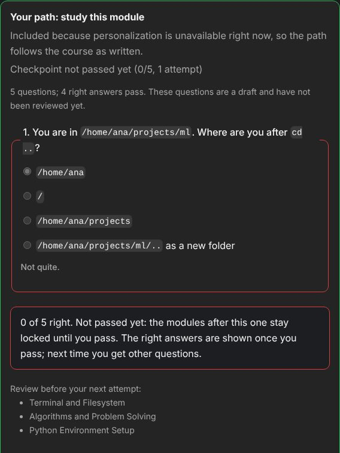
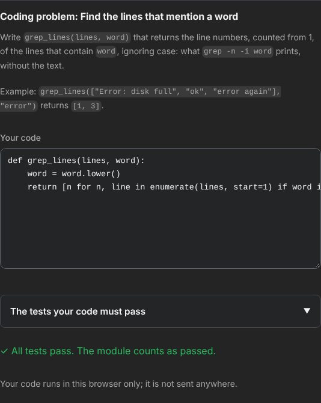

# Personalized Learning Roadmap (DotPath)

> Everyone gets the same learning path, most people abandon it, and nobody finds out whether anything was learned.

An AI system that builds a **personal path through a real technical curriculum**, the HumbleBeeAI Open
Curriculum ([roadmap.humblebee.ai](https://roadmap.humblebee.ai)). It suggests the learner's level and says why,
marks every module to study, prove or skip with a reason, and checks understanding after each module before the
learner moves on.

**Live:** https://dotpath.polarislearning.me/personal-path/ (since 21 November 2026); on a school's own site
through one script tag: https://school.polarislearning.me (since 24 November 2026, see [embed/](embed/README.md)).

Capstone project **S2** — Convergence of Business Administration & Engineering Capstone Design,
Inha University (IBT / ISE), Fall 2026, in partnership with HumbleBeeAI. Team 3, Polaris.

**Status (20 November 2026).** The Baseline, the Target and three of the four Stretch items are built and
tested: 248 automated tests pass, the whole flow runs with GPT-6 Luna, and five learners outside the team used
it. Not built: peer recommendation (Stretch). Known limits are listed under
[Test results and limitations](#test-results-and-limitations).

## Documents

| Document | Contents |
|---|---|
| [docs/project-overview.md](docs/project-overview.md) | Problem, buyer, why AI, Baseline/Target/Stretch and their status, data, tools |
| [docs/architecture.md](docs/architecture.md) | C4 Level 1 and Level 2 diagrams and the decisions behind them |
| [docs/data-sources.md](docs/data-sources.md) | The curriculum, the model, what we keep about learners |
| [docs/test-plan.md](docs/test-plan.md) | Each Baseline, Target and Stretch item, its test and its result |
| [docs/learner-testing.md](docs/learner-testing.md) | How we tested with five learners and what changed after |
| [docs/questions.md](docs/questions.md) | Questions we had and what was decided |
| [docs/test-results/](docs/test-results/) | Model quality reports and the expected decisions |
| [docs/team-rnr.md](docs/team-rnr.md), [docs/ground-rules.md](docs/ground-rules.md) | Roles; how the team works |
| [checkpoints/README.md](checkpoints/README.md) | How checkpoints are made and reviewed |
| [deploy/README.md](deploy/README.md) | Running the site and the API on one server |

## The problem and the buyer

A fixed path fails in two directions: experienced learners quit out of boredom because the early material
repeats what they know, and beginners quit out of overwhelm because they reach material that assumes knowledge
nobody checked. Nothing verifies that a module was understood.

**Buyer (business plan):** the owner of a paid technical course without an ML team of their own — small online schools and
mid-sized programming course platforms. For them a learner who stops is a refund, a cancelled subscription or a
lost next sale. The learner uses DotPath for free; the course owner pays per active learner.

## How it works

1. **Onboarding.** Seven questions: five answered by choosing, each with optional details; one short code
   question; the goal in the learner's own words. A demo can start from one of three invented learners.
2. **Level.** The model suggests beginner, intermediate or advanced, with the evidence and how sure it is. The
   learner can choose another level.
3. **Path.** Every module in course order, marked *study*, *prove* or *skip* with a reason. Inside a module the
   learner can study, skim or skip each topic. The learner can change any decision and confirms the path.
4. **Checkpoints.** After a module: five questions from the topics the learner did not skip (four
   multiple-choice and, where the module has them, one open question marked by the model); four right answers
   pass. Modules that teach programming add a coding problem, run in the learner's browser against tests. A
   failed checkpoint locks later modules until a retake passes, turns *prove* into *study*, and puts skimmed
   topics it got wrong back to full study.
5. **Adaptation.** After an effortless pass or a failure, the model suggests lighter or heavier later modules
   and topics; the learner accepts or declines each. A new goal replans the rest of the path, keeping what was
   started.
6. **Projects.** A capstone has no checkpoint: the learner submits the project and an AI reviewer grades it
   against the capstone's rubric (see [Checkpoints and project review](#checkpoints-and-project-review)).

The path is shown in a panel beside the course pages, which the learner can widen. An assistant in the panel
answers questions about the path, the learner's project reviews and the last error. A learner can share a
read-only link to what they finished. The path lives on our server under an account (Google, or email and
password); a path planned before signing up is kept for a day. The learner can delete the account with
everything in it.

## Architecture

A Python core with a command line, and an HTTP API (FastAPI) that puts it behind the curriculum site, because
the site is static and cannot hold model keys. Accounts, paths, submitted projects, question reports and shared
progress are kept in PostgreSQL (SQLite files without `DATABASE_URL`, for tests and local use). The learner's
page is React code added to the curriculum site (Docusaurus); it is kept in [site/](site/README.md), with a patch
for the site's own files.
Diagrams: [docs/architecture.md](docs/architecture.md).

The model makes the judgement calls: the level, each module's decision, suggestions, open answers and project
reviews. Code keeps the course order, checks that every module got a decision, grades multiple-choice
questions, applies locks and adds the attribution, so a path never contains a link the model made up.

| Path | Contents |
|---|---|
| `src/roadmap/` | The core, the command line and the HTTP API |
| `src/roadmap/prompts/` | Model instructions as Markdown, editable without touching code |
| `config/` | Curriculum versions, onboarding questions, example learners, model providers |
| `checkpoints/` | Questions and coding problems, one file per module and curriculum version |
| `site/` | The learner's page: React code for the curriculum site, and a patch for the site's own files |
| `embed/` | The same panel on any school's website from one script tag, and a demo school |
| `deploy/` | Docker Compose for the site, the API, PostgreSQL and HTTPS on one server |
| `tests/` | Tests; the model is replaced by a stub, the curriculum by a small invented course |

Starter template: [module-python-template](https://github.com/humblebeeai/module-python-template). We kept its
layout, packaging and automatic checks (before each commit and on every pull request, which also runs the
tests). Left out: PyPI publishing, release automation and the MkDocs site.

## Content source, licence and attribution

| | |
|---|---|
| Dataset | HumbleBeeAI Open Curriculum |
| Source | https://roadmap.humblebee.ai · https://github.com/humblebeeai/int.academy-curriculum |
| Licence | **CC BY-NC-SA 4.0** — attribution, share-alike, non-commercial |
| Versions | New paths: commit [`9fc5573`](https://github.com/humblebeeai/int.academy-curriculum/commit/9fc5573ddbd7be5d5da997a26c49afeafbfe6210) (22 October 2026, 20 modules). Still served: [`5c21272`](https://github.com/humblebeeai/int.academy-curriculum/commit/5c212720af50ffd0a1592ea6c0f812c3af733ed3) (the site's "October 6, 2026" version, 18 modules), used by the model runs of 21 October |
| Personal data | None in the source content |

Learning content is © HumbleBeeAI, used under CC BY-NC-SA 4.0. Every module in a path carries its title and
URL, the path carries the licence, and the page shows the attribution under every path. The curriculum is not
copied into this repository; it is fetched at pinned versions. The resources it links to keep their own
licences; we link to them and do not copy them.

**This repository has two licences:** source code under **MIT** (as the starter template), and documentation
and curriculum-derived material (paths, checkpoints) under **CC BY-NC-SA 4.0**. HumbleBeeAI, the project's
partner, gave us its course to use, and DotPath runs only on its site (Q-001). The source states its licence
inconsistently (some files say CC BY-SA); we follow the stricter reading, as the project brief does.

## Learner data

Answers go to our API and to the model provider. With an account we keep the email, a scrypt hash of the
password (or Google's id), the path with the onboarding answers, and submitted projects with their reviews,
until the learner deletes the account. A question the learner reports as wrong is kept with the account's id and
their comment, and stays after the account is deleted. A learner can share anonymous progress (which modules they
finish, fail or stop at). Assistant messages are not kept. **No learner
data is in this repository.** Details: [docs/data-sources.md](docs/data-sources.md).

## Setup

Python 3.11 or newer and Git. From the repository root:

```bash
python -m venv .venv
```

Activate it (`.venv\Scripts\activate` on Windows, `source .venv/bin/activate` elsewhere), then:

```bash
pip install -e ".[api,test,dev]"
```

```bash
pre-commit install
```

```bash
python -m roadmap fetch
```

`pre-commit install` turns the checks on: a commit with a key or a password is stopped, code is formatted, and
commits straight to `main` are refused.

Copy `.env.example` to `.env` and add a model key: `LLM_API_KEY_OPENAI` (the default, GPT-6 Luna), or
`LLM_API_KEY_GOOGLE` or `LLM_API_KEY_GROQ` (free tiers). `LLM_PROVIDER` picks one; otherwise the first provider
in [config/llm.yaml](config/llm.yaml) with a key is used. Without a key everything runs, but paths follow the
course as written.

### Run the page locally

The API, from this repository (`API_COOKIE_SECURE=false` in `.env` lets sign-in work over plain http):

```bash
uvicorn roadmap.api:app --app-dir src --port 8000
```

The site: the curriculum repository at commit `9fc5573` with `site/src` copied in and `site/upstream.patch`
applied, as [site/README.md](site/README.md) shows (Node.js 20 or newer). Then:

```bash
PERSONAL_PATH_API=http://localhost:8000 npm start
```

Then open http://localhost:3000/personal-path. The API's endpoints are listed at http://localhost:8000/docs. On
a server, use [deploy/](deploy/README.md).

### Command line

| Command | What it does |
|---|---|
| `python -m roadmap fetch` | Checks out every curriculum version in `config/curriculum.yaml` |
| `python -m roadmap plan p1` | The path for example learner P1; `--level` overrides the level, `--out` saves the JSON |
| `python -m roadmap compare` | Paths for all example learners and how much each pair differs |
| `python -m roadmap checkpoints <module id>` | Writes a checkpoint with the model for review; `--all` for every module, `--verify` runs the reference solutions |
| `python -m roadmap report` | Where learners who share their progress stop, per module |
| `pytest` | The tests |

`--curriculum 2026-10-06` uses the older version; `--provider` switches the model provider for one run;
`--verbose` logs the time and tokens of every model call.

## Checkpoints and project review

Checkpoints are written once per module and curriculum version and kept in `checkpoints/`, so learners never
wait for a model on multiple-choice questions and grading is code. Each topic has a pool of questions; an
attempt shows five, with the options in a new order, and the next attempt takes other questions. Right answers
appear only after a pass; a failed attempt names the topics to review. Learners can report a wrong question in
one click; reviewers see the reports on the site. How checkpoints are made and reviewed:
[checkpoints/README.md](checkpoints/README.md).

The coding problem runs in the learner's browser with Pyodide; the server never runs a learner's code, so it
takes the browser's word that the tests passed. A generated problem also ships wrong solutions that its tests
must reject, so a weak test is caught before learners see it.

A capstone is submitted as a public GitHub link or a .zip/.tar.gz archive (up to 20 MB). The AI reviewer
(`src/roadmap/project_review.py`) says for each rubric criterion whether it is met, with a file and a quote as
evidence; code checks that every quote is really in the project. Three reviews run at once and each criterion is
decided by majority. The reviewer reads the code but does not run it, so a claim about how the project behaves
counts only with the code and its saved output, never with numbers typed into the README. People in
`API_REVIEWER_EMAILS` see every decision on the site's `/review` page and can change it. Archives are read in
memory within size limits and never unpacked or run.

## Model and fallback

The default is OpenAI `gpt-6-luna`: about $0.002 a path and about $0.04 a learner over a whole course (token
counts from our server's log on 20 November 2026; how often a learner uses each feature is our estimate). Gemini
and Groq stay available on their free tiers (Q-003). If a model fails or leaves a module out, the provider's next
model is tried; if none answers, the path is the whole course in its own order and the learner is told that
personalization is unavailable. Nothing is skipped without a model. Checkpoints keep working without one, the
open question is left out, there are no suggestions, and a goal change is refused.

## Example output

The page on the curriculum site, run locally on 5 November without a model key, so the path is the fallback
(every module to study); checkpoints, the coding problem and progress work as with a model.

| | |
|---|---|
|  |  |
| The questions, filled in from invented learner P1 | The confirmed path: the goal, the next module, the counts and the hours |
|  |  |
| A failed attempt: wrong answers marked, right answers hidden, topics to review | The coding problem after the questions, its tests passed in the browser |

## Test results and limitations

- **Automated tests:** 248 pass (24 November 2026), with a stub model: parsing both curriculum versions, course
  order, attribution, the fallback, accounts, checkpoint grading, locks, topics, suggestions, goal change,
  project review and the report. Eight run on the real curriculum after `python -m roadmap fetch`.
- **With the real model:** the whole flow — level, path, checkpoints with open questions, suggestions
  after a checkpoint, the assistant, project review and goal change — ran with GPT-6 Luna on 20 November 2026.
- **Model quality,** 5 runs per profile, scored against the
  [expected decisions](docs/test-results/expected-decisions.md):
  - current curriculum, `gpt-6-luna` ([report](docs/test-results/2026-11-20-current-curriculum.md)): 87% of
    decisions stable across runs, 98% match; repeated error: P3 skips LLM Fundamentals;
  - October 6 version, `gemini-3.5-flash-lite` ([report](docs/test-results/2026-10-21-model-stability.md)): 93%
    stable, 96% match; repeated error: P1 is asked to prove Data Manipulation without NumPy or Pandas.
- **Learners:** five people outside the team used it in November 2026. The suggested decisions matched what
  they knew. After the sessions we replaced open onboarding questions with choices, let the panel be widened,
  made the coding editor behave like an IDE, and fixed smaller interface issues
  ([learner-testing.md](docs/learner-testing.md)).

Limitations:

- Model quality is measured on three invented profiles, not real learners.
- A coding problem counts as solved on the browser's word.
- The project reviewer does not run the code.

## Team

| Name | Role |
|---|---|
| Li Mikhail | PM, AI / Engineering |
| Abdulkhaev Akbarjon | Problem & Business |
| Jalilov Jakhongir Zukhriddin ugli | Data & Research |
| Chagai Vladimir | AI / Engineering |
| Imetov Daniiar | Demo & Presentation |

Student IDs, responsibilities and reviewers: [docs/team-rnr.md](docs/team-rnr.md).

## Use of AI tools

Claude (Anthropic) was used throughout; GPT-6 Luna is part of the product.

- **Documents.** Much of the documentation was drafted with Claude and edited by the team. Facts were checked
  against the S2 brief, the source repository's licence files and our own parsing of the curriculum.
- **Code.** The core, the API, the page on the curriculum site and `deploy/` were written with Claude. The tests
  were run, module URLs were checked against the site's sitemap, and the page was checked in a browser.
- **Data.** The expected decisions in `docs/test-results/` were drafted with Claude; the checkpoints were
  generated with GPT-6 Luna, except three written with Claude during development.
