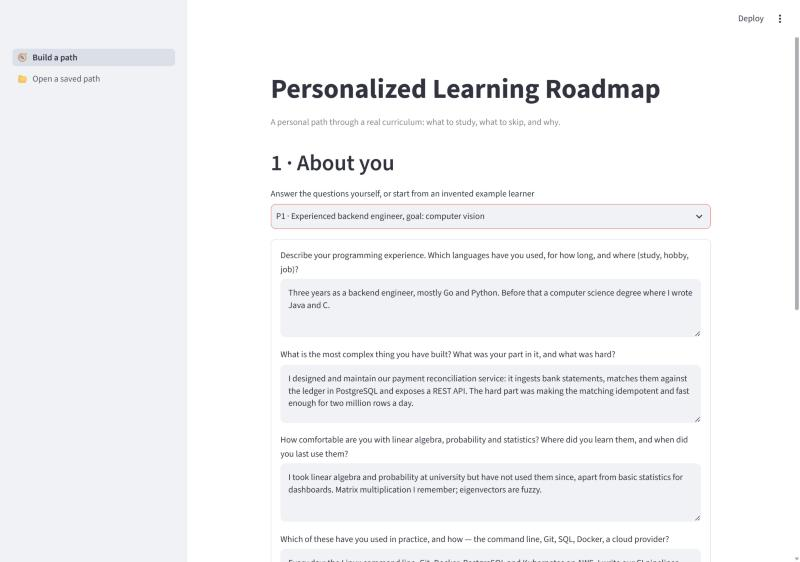
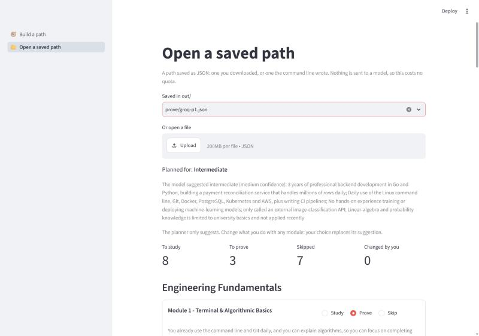
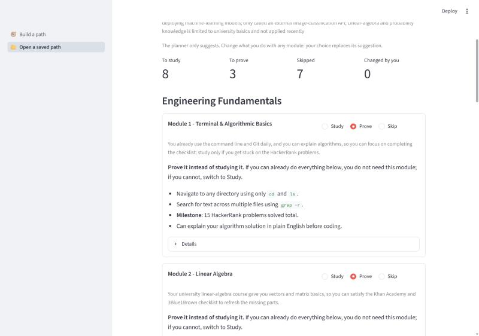
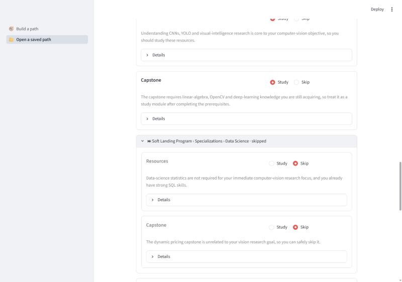
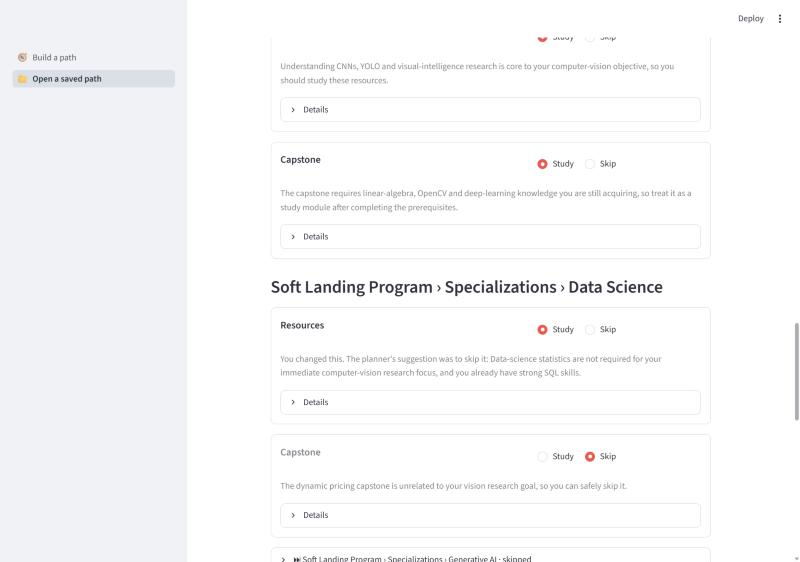
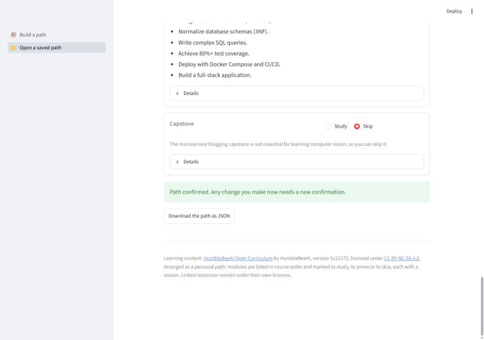

# Personalized Learning Roadmap

> Everyone gets the same learning path, most people abandon it, and nobody finds out whether anything was learned.

An AI system that builds a **personalized path through real technical learning content**
([roadmap.humblebee.ai](https://roadmap.humblebee.ai)): it infers the learner's level from open-ended
answers and explains that inference, orders the material toward the learner's goal, marks and justifies what
was skipped, and — from the Target tier onward — verifies understanding with checkpoints before letting the
learner move on.

Capstone project **S2** — Convergence of Business Administration & Engineering Capstone Design,
Inha University (IBT / ISE), Fall 2026, in partnership with HumbleBeeAI.

Status: the Baseline works as a prototype — questions, a level suggestion the learner can correct, a personal
path and a web page. Checkpoints (Target) are not built yet.

## Documents

| Document | Contents |
|---|---|
| [docs/project-overview.md](docs/project-overview.md) | Problem, buyer, why AI, implementation plan, Baseline/Target/Stretch, data, tools, hard parts |
| [docs/team-rnr.md](docs/team-rnr.md) | Role owners, what each member owns, reviewers |
| [docs/ground-rules.md](docs/ground-rules.md) | How the team meets, reviews code and handles data |
| [docs/questions.md](docs/questions.md) | Open questions, assumptions and decisions we would like feedback on |
| [docs/architecture.md](docs/architecture.md) | C4 Level 1 and Level 2 diagrams |
| [docs/data-sources.md](docs/data-sources.md) | Data sources, access and limitations |
| [docs/test-plan.md](docs/test-plan.md) | Test scenarios mapped to Baseline/Target DoD items, current stage and status of each |

## The problem

Free technical learning material is abundant; completion is not. A fixed path fails in two directions at
once: experienced learners quit out of boredom because the early material repeats what they know and there
is no way to say so, and beginners quit out of overwhelm because they reach material assuming knowledge
nobody checked they had. Nothing verifies that a section was understood, so learners advance on the feeling
of having read something.

**Buyer:** a learning platform or content publisher with a completion problem. They can see where learners
drop out and cannot fix it, because the content is fixed and the audience is not. Value is measured directly
in completion and retention.

## How it works

1. **Onboarding** — open-ended questions about coding background and end goal.
2. **Level inference** — a model infers the level and states the reasoning; the learner can correct it, and
   the correction is what the planner uses. The inference is a suggestion, never a verdict.
3. **Path generation** — the curriculum's modules in course order, each marked *study*, *prove* or *skip*
   with a reason. *Prove* is offered for modules that have a completion checklist: the learner works through
   the checklist instead and studies the module only if they cannot complete it. The learner can change any
   decision and confirms the path before using it.
4. **Checkpoints** *(Target)* — questions generated from the content; progress is gated on them.
5. **Adaptation** *(Target)* — a failed checkpoint replans the remainder of the path.

## Architecture and starter template

Starter template: [module-python-template](https://github.com/humblebeeai/module-python-template).

Chosen because the planner and the attribution logic are library code. The Streamlit interface calls the
library directly, so there is no HTTP layer, and no database until there is state to keep between sessions.

From the template we took the project layout, the packaging setup and the automatic checks, which run before
each commit and again on every pull request. Our changes: Python 3.11, the pull-request checks also run the
tests, and markdownlint is off because its fixes would rewrite documents the whole team edits. Left out:
PyPI publishing, release automation and the MkDocs site — we publish no package.

C4 Level 1 and Level 2 diagrams: [docs/architecture.md](docs/architecture.md).

| Path | Contents |
|---|---|
| `src/roadmap/` | The core library and its command line: curriculum parser, level inference, planner, fallback |
| `src/roadmap/prompts/` | Model instructions as Markdown, editable without touching code |
| `app/` | The demo web interface (Streamlit), a client of the core |
| `config/` | Curriculum pin and attribution, onboarding questions, invented example profiles |
| `tests/` | Tests; the model is replaced by a stub, the curriculum by a small invented course |

The model makes the judgement calls: the level, and what to do with each module. Code keeps the course order,
checks that every module got a decision and adds the attribution, so a path never contains a link the model
made up.

## Content source, licence and attribution

| | |
|---|---|
| Dataset | HumbleBeeAI Open Curriculum |
| Source | https://roadmap.humblebee.ai · repository https://github.com/humblebeeai/int.academy-curriculum |
| Licence | **CC BY-NC-SA 4.0** — attribution required, share-alike applies to derivatives, non-commercial |
| Version | New paths: the current curriculum, commit [`9fc5573`](https://github.com/humblebeeai/int.academy-curriculum/commit/9fc5573ddbd7be5d5da997a26c49afeafbfe6210), 22 October 2026. Still served, and used by the model runs of 21 October: commit [`5c21272`](https://github.com/humblebeeai/int.academy-curriculum/commit/5c212720af50ffd0a1592ea6c0f812c3af733ed3), 7 September 2026, the site's "October 6, 2026" version |
| Personal data | None in the source content |
| Preprocessing | MDX parsed into modules, resources, prerequisites and checklists |

Learning content is © HumbleBeeAI, used under CC BY-NC-SA 4.0. Every module in a generated path carries its
title and URL, and the path carries the licence.

### How we comply

A generated path orders the curriculum's modules and includes their titles, descriptions and checklists.
Whether that makes it an adaptation is open (Q-001), so we license it under CC BY-NC-SA 4.0, which is safe
under either reading. We do not sell the tool, charge for access, or ship the content into a commercial
product.

**This repository is licensed in two parts:** source code under **MIT** (matching the starter template), and
documentation plus anything derived from the curriculum, such as generated paths, under
**CC BY-NC-SA 4.0**. Share-alike follows the content into its adaptations, but not into independent software
that reads it. The curriculum is not copied into this repository; it is fetched from its own repository at a
pinned version.

The source states its licence inconsistently: `LICENSE`, its README and the licensing section of
`CONTRIBUTING.md` say CC BY-NC-SA 4.0, while one line of `CONTRIBUTING.md` and both `llms.txt` files say
CC BY-SA 4.0, without the non-commercial term. We follow the stricter reading, which is also what the
project brief states. Whether a generated path counts as an adaptation is Q-001 in
[docs/questions.md](docs/questions.md), pending confirmation by the professors; attribution applies either way.

The 116 external resources the curriculum links to stay under their own licences — we link to them and keep
their metadata, and do not copy their content.

## Learner data

Any data collected while testing with real learners is kept to the minimum needed, participants are told
what is collected, and **no learner data is published in this repository**.

## Setup

Python 3.11 or newer and Git. From the repository root:

```bash
python -m venv .venv
```

Activate it (`.venv\Scripts\activate` on Windows, `source .venv/bin/activate` elsewhere), then:

```bash
pip install -e ".[app,test,dev]"
```

```bash
pre-commit install
```

```bash
python -m roadmap fetch
```

`pre-commit install` turns the checks on: a commit that contains a key or a password is stopped, code is
formatted, and commits straight to `main` are refused. Files uploaded through the GitHub website skip these
checks; the pull request runs them.

To personalize paths, copy `.env.example` to `.env` and add `LLM_API_KEY_GROQ` or `LLM_API_KEY_GOOGLE`.
`LLM_PROVIDER` chooses one; otherwise the first provider in [config/llm.yaml](config/llm.yaml) with a key is
used. Without a key the app still runs, but paths follow the course as written.

| Command | What it does |
|---|---|
| `streamlit run app/streamlit_app.py` | The demo web interface: build a path, or open a saved one (JSON) without asking a model |
| `python -m roadmap plan p1` | The path for example profile P1 in the terminal; `--level advanced` overrides the level, `--out out/p1.json` saves the JSON |
| `python -m roadmap compare` | Paths for all example profiles and how much each pair differs |
| `pytest` | The tests |

`plan` and `compare` take `--provider google` to switch provider for one run, and `--verbose` to log the time
and tokens of every model call.

### HTTP API for the curriculum site

A page on the curriculum site can plan paths through an HTTP API, so that the model keys stay on a server:

```bash
pip install -e ".[api]"
```

```bash
uvicorn roadmap.api:app --app-dir src --port 8000
```

`GET /questions` gives the onboarding questions and the curriculum version, `POST /level` a suggested level
and `POST /path` a path in the same JSON the app downloads. The browser changes decisions and confirms the
path itself. `API_ALLOWED_ORIGINS` (comma-separated, default `http://localhost:3000`) lists the sites that
may call it; `API_RATE_LIMIT` and `API_RATE_WINDOW` (default 20 model calls per client an hour) share the
free-tier quota between learners. The limit is kept in memory, so it holds for one server process.

### Checkpoints and progress (Target)

Each module can have a checkpoint: ten questions in `checkpoints/<module id>.yaml`, generated once and
reviewed by a person before learners see them (see [checkpoints/README.md](checkpoints/README.md)):

```bash
python -m roadmap checkpoints engineering-fundamentals/data-manipulation
```

A learner takes five questions an attempt and passes with four; the API grades the answers, so the browser
never receives them. The options are shuffled for each attempt, and the right answers appear only after a pass:
a failed attempt names the topics to review instead. Modules that teach programming add a coding problem after
the questions: the learner's code runs in their browser with Pyodide against the problem's tests, and the
module counts as passed when they pass (`python -m roadmap checkpoints --verify` checks the reference
solutions). A failed checkpoint locks the modules after it until a retake passes, and turns "prove"
into "study". A checkpoint passed without a mistake at the first try asks the model whether later modules can
be lightened; the learner accepts or declines each suggestion. Progress lives in the path: in the browser on
the curriculum site, and in the JSON the learner downloads. There are no accounts, so the lock holds in the
interface but a learner can bypass it by editing their path.

The checkpoints in `checkpoints/` (two modules per curriculum version) are drafts written by Claude during
development so the flow can be shown; they are not generator output and are not reviewed.

### Goal change, shared progress and time

- **A new goal mid-path.** The learner enters it on the path page; the rest of the path is planned again by
  the model, modules they have started keep their decision and progress, and they confirm the path again.
  Without a model the path stays as it is.
- **Where learners stop.** A learner can choose to share anonymous progress: a random path id, the modules
  their path includes, and which they finish or fail; never their answers or anything that identifies them.
  `GET /report` (with `API_REPORT_TOKEN`) or `python -m roadmap report` counts, per module, the shared paths
  that include it, finish it, fail its checkpoint, and stop at it. See [docs/data-sources.md](docs/data-sources.md).
- **Time.** The path shows its hours against the whole course's, from the authors' workload estimates or the
  durations of a module's resources. The current curriculum states few of either, so most of its modules have
  no estimate; the page says how many.

### Deploying

[deploy/](deploy/README.md) runs the curriculum site, the API and Caddy (HTTPS) on one server with Docker
Compose.

## How to obtain the data

`python -m roadmap fetch` clones the curriculum once into `data/curricula/repository/` (git-ignored) and checks
out every version in [config/curriculum.yaml](config/curriculum.yaml) next to it, one folder per version. The
repository is public and needs no credentials.

**Curriculum versions.** New paths use the first version in the config, the current curriculum. A path planned
for another listed version keeps working against that version, and links to that version's pages on the site,
so learners keep their progress when the course changes. The current curriculum retired several modules
(`unlisted` pages, which are left out) and states what finishes a module under "Expected output" and "Finish
this module" rather than in tick boxes; `completion_headings: true` reads those. The October 6 version is read
exactly as before, so the model runs of 21 October are reproducible with `--curriculum 2026-10-06`:

```bash
python -m roadmap compare --curriculum 2026-10-06
```

The curriculum stays outside this repository; usage conditions are in the licence section above.

## Fallback when the model is unavailable or rate-limited

If a model is rate-limited, down, or gives a plan that leaves a module out, the next model listed for the
provider in [config/llm.yaml](config/llm.yaml) is tried; free-tier quotas are counted per model. If no model
answers, the path is the whole course in its own order and the learner is told that personalization is
unavailable. Nothing is skipped without a model: a wrong skip does more harm than repeating familiar material.
Gemini comes first; Groq is used when `LLM_PROVIDER=groq` or there is no Google key (Q-003).

## Example output

The path for example profile P1, built by `openai/gpt-oss-120b` on 3 October and opened on the saved-path page.

| | |
|---|---|
|  |  |
| Onboarding, filled in from P1 | The suggested level with its evidence; how many modules to study, prove or skip |
|  |  |
| "Prove": the module's checklist instead of studying it | Study and skip, each with a reason |
|  |  |
| The learner changed a skip to study; the planner's suggestion stays visible | The confirmed path can be downloaded; attribution below |

## Test results, known errors and limitations

`pytest` checks everything code decides — parsing, course order, attribution, the fallback, the learner's
changes and both web pages — with a stub in place of the model. Three of the tests run on the real
curriculum: 18 modules, 116 resources, page URLs as on the site.

Model runs on 21 October, 3–5 per profile and model ([report](docs/test-results/2026-10-21-model-stability.md)).
With `gemini-3.5-flash-lite`, 93% of decisions stayed the same across runs and 96% matched the
[expected decisions](docs/test-results/expected-decisions.md); the paths of P1 and P2 differ by 40–50%. Its
one repeated error: P1, who has never used NumPy or Pandas, is asked to prove the module that teaches them.

Not tested yet: level inference against what real learners say about themselves (Target).

## Team

| Name | Role |
|---|---|
| Li Mikhail | PM, AI / Engineering |
| Abdulkhaev Akbarjon | Problem & Business |
| Jalilov Jakhongir Zukhriddin ugli | Data & Research |
| Chagai Vladimir | AI / Engineering |
| Imetov Daniiar | Demo & Presentation |

Umaraliev Makhmudjon, our first project manager, is on academic leave. Student IDs, what each person is
responsible for and who reviews their work are in the role sheet:
[docs/team-rnr.md](docs/team-rnr.md).

## Use of AI tools

A substantial part of the documentation here is written with AI
assistance (Claude).

For this submission we checked the Baseline, Target and Stretch items against the S2 project brief, the
licence in the source repository's own files, and the content statistics in the overview, which come from
parsing the source repository rather than from a model.

Drafts were edited rather than taken as they came.

The prototype code (`src/`, `app/`, `tests/`, `config/`) was written with AI assistance (Claude). Its tests
were run, and the module URLs it builds were checked against the curriculum site's sitemap.

The HTTP API, the checkpoints and progress (`src/roadmap/api.py`, `src/roadmap/checkpoints.py`, the progress
rules in `src/roadmap/path.py`) and the personal path page for the curriculum site were written with Claude.
The two draft checkpoints in `checkpoints/` were written by Claude and still need review by someone who knows
the topic. The curriculum versions, coding problems, goal change, shared progress, time estimates and
`deploy/` were written with Claude too. The tests pass with a stub model, and the site flow was checked in a
browser at desktop and phone width; checkpoint generation, the suggestions after a checkpoint and goal change
have not been run with a real model yet, and the Docker setup has not been built on a server yet.
