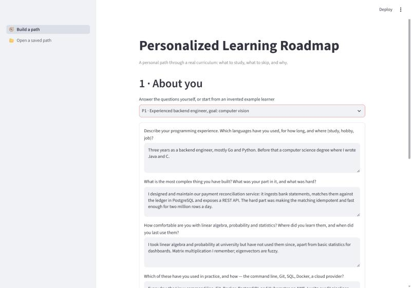
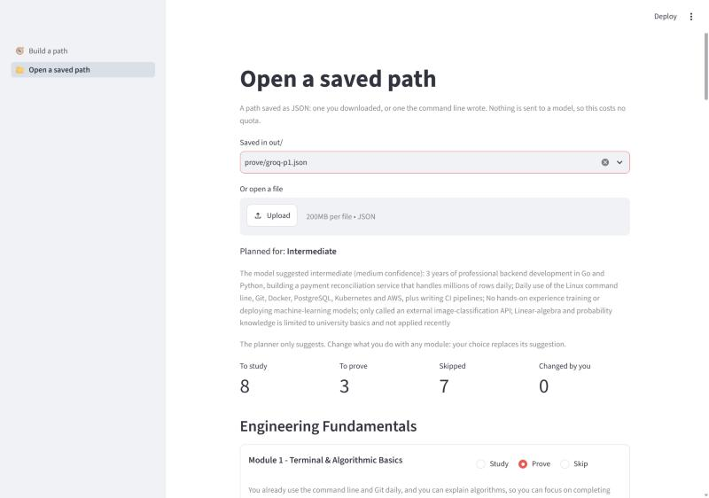
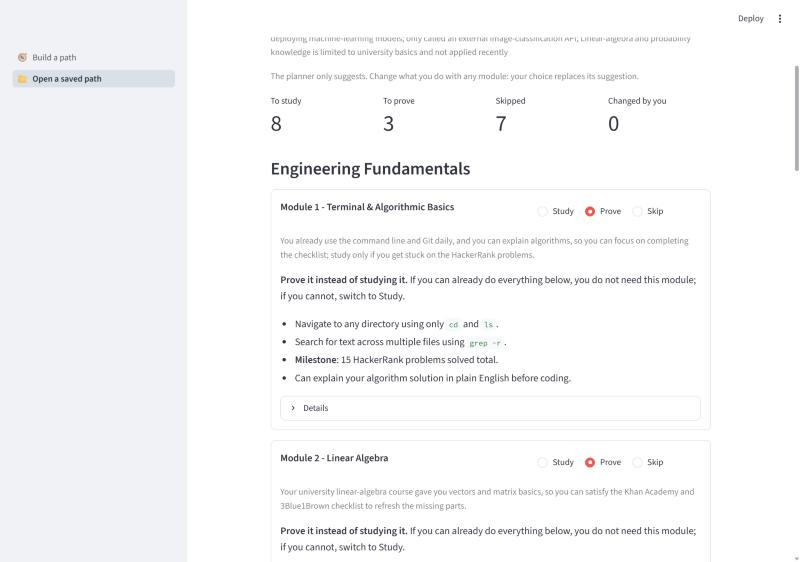
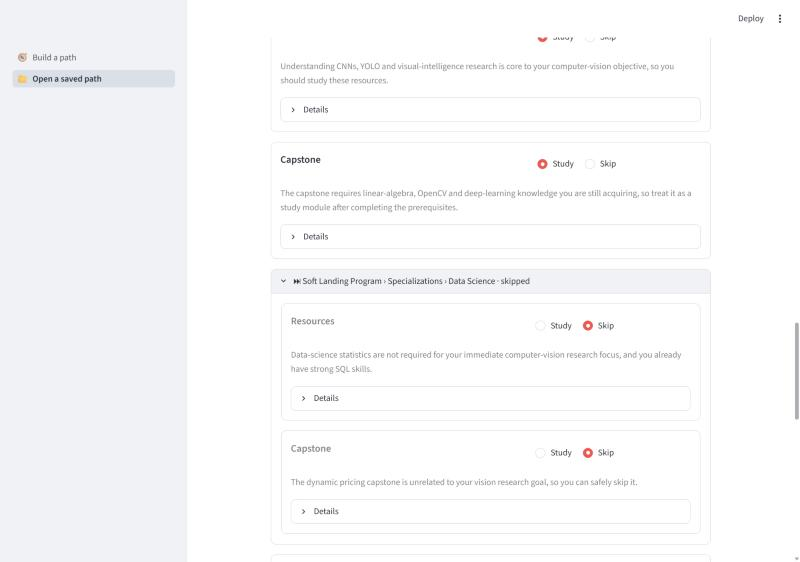
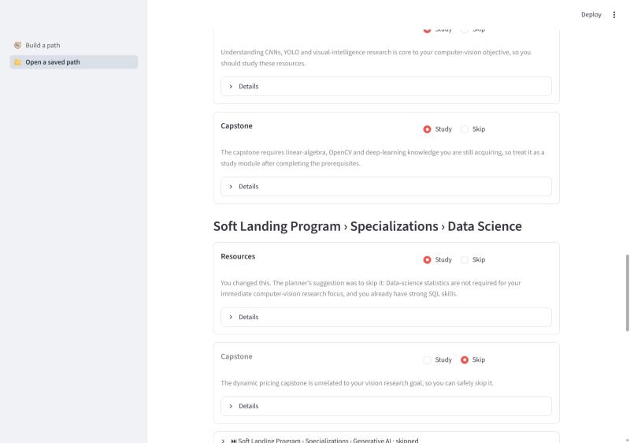
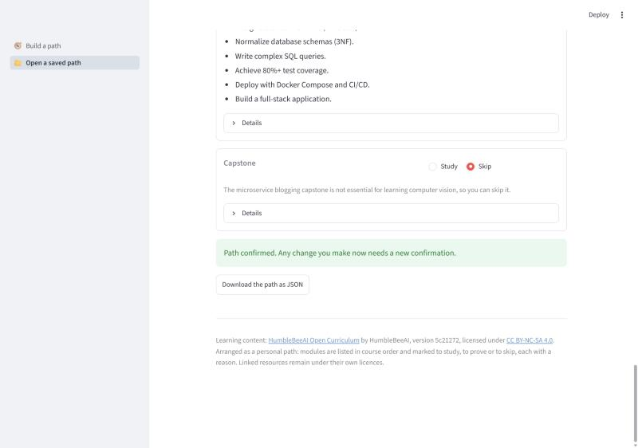

# Personalized Learning Roadmap

> Everyone gets the same learning path, most people abandon it, and nobody finds out whether anything was learned.

An AI system that builds a **personalized path through real technical learning content**
([roadmap.humblebee.ai](https://roadmap.humblebee.ai)): it infers the learner's level from open-ended
answers and explains that inference, orders the material toward the learner's goal, marks and justifies what
was skipped, and — from the Target tier onward — verifies understanding with checkpoints before letting the
learner move on.

Capstone project **S2** — Convergence of Business Administration & Engineering Capstone Design,
Inha University (IBT / ISE), Fall 2026, in partnership with HumbleBeeAI.

Status: the Baseline works as a prototype — questions, a level suggestion the learner can correct, a personal
path and a web page. Checkpoints (Target) are not built yet.

## Documents

| Document | Contents |
|---|---|
| [docs/project-overview.md](docs/project-overview.md) | Problem, buyer, why AI, implementation plan, Baseline/Target/Stretch, data, tools, hard parts |
| [docs/team-rnr.md](docs/team-rnr.md) | Role owners, what each member owns, reviewers |
| [docs/ground-rules.md](docs/ground-rules.md) | How the team meets, reviews code and handles data |
| [docs/questions.md](docs/questions.md) | Open questions, assumptions and decisions we would like feedback on |
| [docs/architecture.md](docs/architecture.md) | C4 Level 1 and Level 2 diagrams |
| [docs/data-sources.md](docs/data-sources.md) | Data sources, access and limitations |
| [docs/test-plan.md](docs/test-plan.md) | Test scenarios mapped to Baseline/Target DoD items, current stage and status of each |

## The problem

Free technical learning material is abundant; completion is not. A fixed path fails in two directions at
once: experienced learners quit out of boredom because the early material repeats what they know and there
is no way to say so, and beginners quit out of overwhelm because they reach material assuming knowledge
nobody checked they had. Nothing verifies that a section was understood, so learners advance on the feeling
of having read something.

**Buyer:** a learning platform or content publisher with a completion problem. They can see where learners
drop out and cannot fix it, because the content is fixed and the audience is not. Value is measured directly
in completion and retention.

## How it works

1. **Onboarding** — open-ended questions about coding background and end goal.
2. **Level inference** — a model infers the level and states the reasoning; the learner can correct it, and
   the correction is what the planner uses. The inference is a suggestion, never a verdict.
3. **Path generation** — the curriculum's modules in course order, each marked *study*, *prove* or *skip*
   with a reason. *Prove* is offered for modules that have a completion checklist: the learner works through
   the checklist instead and studies the module only if they cannot complete it. The learner can change any
   decision and confirms the path before using it.
4. **Checkpoints** *(Target)* — questions generated from the content; progress is gated on them.
5. **Adaptation** *(Target)* — a failed checkpoint replans the remainder of the path.

## Architecture and starter template

Starter template: [module-python-template](https://github.com/humblebeeai/module-python-template).

Chosen because the planner, the prerequisite graph and the attribution logic are library code. The web
interface is a Target item; the HTTP layer it needs is added then, not before, and no database is planned
until there is state to keep between sessions.

From the template we took the project layout, the packaging setup and the automatic checks, which run before
each commit and again on every pull request. Our changes: Python 3.11, the pull-request checks also run the
tests, and markdownlint is off because its fixes would rewrite documents the whole team edits. Left out:
PyPI publishing, release automation and the MkDocs site — we publish no package.

C4 Level 1 and Level 2 diagrams: [docs/architecture.md](docs/architecture.md).

| Path | Contents |
|---|---|
| `src/roadmap/` | The core library and its command line: curriculum parser, level inference, planner, fallback |
| `src/roadmap/prompts/` | Model instructions as Markdown, editable without touching code |
| `app/` | The demo web interface (Streamlit), a client of the core |
| `config/` | Curriculum pin and attribution, onboarding questions, invented example profiles |
| `tests/` | Tests; the model is replaced by a stub, the curriculum by a small invented course |

The model makes the judgement calls: the level, and what to do with each module. Code keeps the course order,
checks that every module got a decision and adds the attribution, so a path never contains a link the model
made up.

## Content source, licence and attribution

| | |
|---|---|
| Dataset | HumbleBeeAI Open Curriculum |
| Source | https://roadmap.humblebee.ai · repository https://github.com/humblebeeai/int.academy-curriculum |
| Licence | **CC BY-NC-SA 4.0** — attribution required, share-alike applies to derivatives, non-commercial |
| Version | Commit [`5c21272`](https://github.com/humblebeeai/int.academy-curriculum/commit/5c212720af50ffd0a1592ea6c0f812c3af733ed3), 7 September 2026 |
| Personal data | None in the source content |
| Preprocessing | MDX parsed into a node graph; prerequisite edges authored by this team |

Learning content is © HumbleBeeAI, used under CC BY-NC-SA 4.0. Every resource emitted in a generated path
carries its source title, URL and licence.

### How we comply

A generated path links to and orders the curriculum without reproducing it, so we read it as a collection
rather than an adaptation. We license it the same way anyway, which is safe under either reading. Every
resource in an output carries its source title, URL and licence, and we do not sell the tool, charge for
access, or ship the content into a commercial product.

**This repository is licensed in two parts:** source code under **MIT** (matching the starter template), and
documentation plus anything derived from the curriculum — the parsed graph, generated paths — under
**CC BY-NC-SA 4.0**. Share-alike follows the content into its adaptations, but not into independent software
that reads it. The curriculum is not copied into this repository; it is fetched from its own repository at a
pinned version.

The source states its licence inconsistently: `LICENSE`, its README and the licensing section of
`CONTRIBUTING.md` say CC BY-NC-SA 4.0, while one line of `CONTRIBUTING.md` and both `llms.txt` files say
CC BY-SA 4.0, without the non-commercial term. We follow the stricter reading, which is also what the
project brief states. Whether a generated path counts as an adaptation is Q-001 in
[docs/questions.md](docs/questions.md), pending confirmation by the professors; attribution applies either way.

The 116 external resources the curriculum links to stay under their own licences — we link to them and keep
their metadata, and do not copy their content.

## Learner data

Any data collected while testing with real learners is kept to the minimum needed, participants are told
what is collected, and **no learner data is published in this repository**.

## Setup

Python 3.11 or newer and Git. From the repository root:

```bash
python -m venv .venv
```

Activate it (`.venv\Scripts\activate` on Windows, `source .venv/bin/activate` elsewhere), then:

```bash
pip install -e ".[app,test,dev]"
```

```bash
pre-commit install
```

```bash
python -m roadmap fetch
```

`pre-commit install` turns the checks on: a commit that contains a key or a password is stopped, code is
formatted, and commits straight to `main` are refused. Files uploaded through the GitHub website skip these
checks; the pull request runs them.

To personalize paths, copy `.env.example` to `.env` and add `LLM_API_KEY_GROQ` or `LLM_API_KEY_GOOGLE`.
`LLM_PROVIDER` chooses one; otherwise the first provider in [config/llm.yaml](config/llm.yaml) with a key is
used. Without a key the app still runs, but paths follow the course as written.

| Command | What it does |
|---|---|
| `streamlit run app/streamlit_app.py` | The demo web interface: build a path, or open a saved one (JSON) without asking a model |
| `python -m roadmap plan p1` | The path for example profile P1 in the terminal; `--level advanced` overrides the level, `--out out/p1.json` saves the JSON |
| `python -m roadmap compare` | Paths for all example profiles and how much each pair differs |
| `pytest` | The tests |

`plan` and `compare` take `--provider google` to switch provider for one run, and `--verbose` to log the time
and tokens of every model call.

## How to obtain the data

`python -m roadmap fetch` checks the curriculum out into `data/curriculum/` (git-ignored) at the version pinned
in [config/curriculum.yaml](config/curriculum.yaml). The repository is public and needs no credentials. By
hand:

```bash
git clone https://github.com/humblebeeai/int.academy-curriculum data/curriculum
```

```bash
git -C data/curriculum checkout 5c212720af50ffd0a1592ea6c0f812c3af733ed3
```

The curriculum stays outside this repository; usage conditions are in the licence section above.

## Fallback when the model is unavailable or rate-limited

If a model is rate-limited, down, or gives a plan that leaves a module out, the next model listed for the
provider in [config/llm.yaml](config/llm.yaml) is tried; free-tier quotas are counted per model. If no model
answers, the path is the whole course in its own order and the learner is told that personalization is
unavailable. Nothing is skipped without a model: a wrong skip does more harm than repeating familiar material.
Which provider and models to use is still open (Q-003).

## Example output

The path for example profile P1, built by `openai/gpt-oss-120b` on 3 October and opened on the saved-path page.

| | |
|---|---|
|  |  |
| Onboarding, filled in from P1 | The suggested level with its evidence; how many modules to study, prove or skip |
|  |  |
| "Prove": the module's checklist instead of studying it | Study and skip, each with a reason |
|  |  |
| The learner changed a skip to study; the planner's suggestion stays visible | The confirmed path can be downloaded; attribution below |

## Test results, known errors and limitations

`pytest` checks everything code decides — parsing, course order, attribution, the fallback, the learner's
changes and both web pages — with a stub in place of the model. Three of the tests run on the real
curriculum: 18 modules, 116 resources, page URLs as on the site.

First model runs, one per profile on 3 October, so not yet results: the paths of P1 and P2 differ by 40–45%,
and P3 differs from both by 64–69%. Some decisions look wrong and some change between runs; details are in
Q-003. Still to do, and what counts as success:

- **Different paths for different profiles** — the three example profiles are compared against each other;
  success is a difference large enough to be visible without explanation, measured as the share of nodes
  they do not share.
- **Level inference** — compared against what learners say about themselves; success is agreement in most
  cases, with every disagreement explainable from the answers given.
- **Skipped material** — a sample of skip justifications is checked by hand; success is that they hold up
  against the learner's stated background.
- **Stability** — the same profile is run several times; success is that the paths stay within a set
  tolerance of each other.
- **Fallback** — the planner produces a valid path with no model available.

## Team

| Name | Role |
|---|---|
| Umaraliev Makhmudjon | PM |
| Abdulkhaev Akbarjon | Problem & Business |
| Jalilov Jakhongir Zukhriddin ugli | Data & Research |
| Li Mikhail | AI / Engineering |
| Chagai Vladimir | AI / Engineering |
| Imetov Daniiar | Demo & Presentation |

Student IDs, what each person is responsible for and who reviews their work are in the role sheet:
[docs/team-rnr.md](docs/team-rnr.md).

## Use of AI tools

A substantial part of the documentation here is written with AI
assistance (Claude).

For this submission we checked the Baseline, Target and Stretch items against the S2 project brief, the
licence in the source repository's own files, and the content statistics in the overview, which come from
parsing the source repository rather than from a model.

Drafts were edited rather than taken as they came.

The prototype code (`src/`, `app/`, `tests/`, `config/`) was written with AI assistance (Claude). Its tests
were run, and the module URLs it builds were checked against the curriculum site's sitemap.
