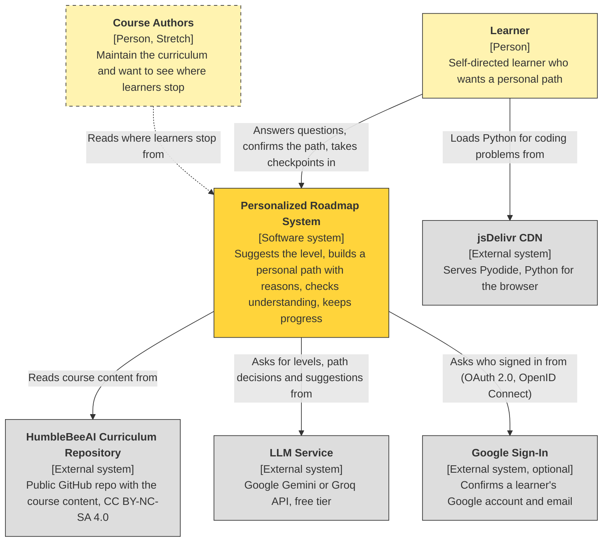
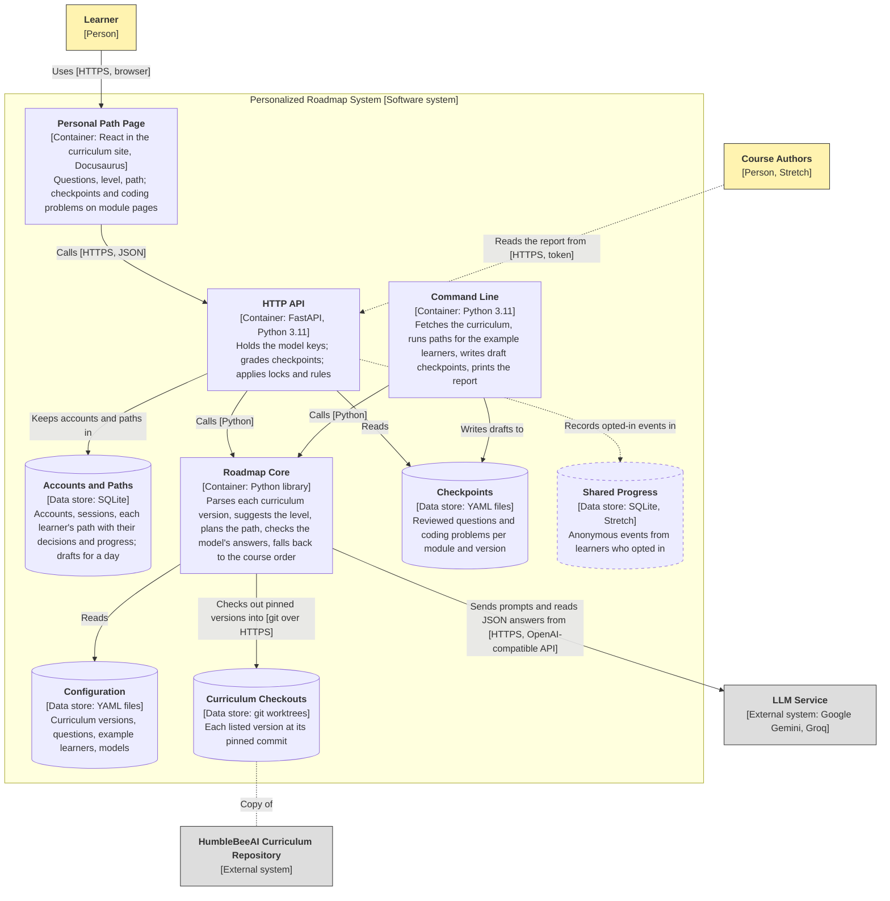

# Architecture: C4 Level 1 and Level 2

**Status:** matches the code on 5 November 2026: the Baseline and the Target code, and two Stretch items built
early. Changes since the 23 September draft are listed at the end.

The diagrams are written in Mermaid, which GitHub draws automatically. **Dashed** boxes and arrows are Stretch
items. We draw only Level 1 and Level 2, as the course guide asks.

---

## C1: System Context

**Question it answers:** who uses the system, what are we building, and what does it connect to outside itself?

**How to read it**

- The yellow box is what our team builds. Everything outside it is a person or an external system we do not control.
- The learner uses the system through a page on the curriculum site. The course authors only read a report of
  where learners who chose to share their progress stop (Stretch).
- We do **not** copy the curriculum into our repository. We read it from its own repository at pinned versions.
- The learner's browser loads Pyodide from the CDN only when they run a coding problem.
- Google takes part only when a learner chooses to sign in with it; no Google script runs on the site.

---

## C2: Container

**Question it answers:** what are the main applications and data stores inside the system, and how do they talk to each other?

### What each container does

| Container | Responsibility | Technology | Tier |
|---|---|---|---|
| Personal Path Page | Asks the questions (or fills them from an example learner), shows the suggested level with its evidence and the path; the learner changes any decision and confirms it. On each module page: the decision, the checkpoint, the coding problem, or "mark as done". Shows progress, the next module, hours, suggestions after a checkpoint and the goal change | React components in our fork of the curriculum site (`src/components/personal-path/`), Docusaurus | Baseline (the path), Target (checkpoints and progress) |
| Accounts and Paths | Accounts (email, scrypt password hash), sessions (hashed tokens, 30 days), each learner's path: decisions, confirmation, progress per module, attempts, locks, suggestions; paths planned before signing up, for a day | SQLite file on the API server (`src/roadmap/accounts.py`, `API_ACCOUNTS_FILE`) | Target |
| HTTP API | Serves questions, example learners, a level and a path; confirms paths; serves checkpoint questions without answers, grades attempts, applies locks and rules; plans the rest of a path for a new goal; records opted-in events and serves the report. Holds the model keys; limits model calls per client | FastAPI (`src/roadmap/api.py`), one uvicorn worker | Target |
| Command Line | Fetches the curriculum versions, runs paths for the example learners and compares them, writes draft checkpoints and checks their coding problems, prints the report | `python -m roadmap` | Baseline |
| Roadmap Core | Parses each curriculum version into modules; suggests the level and explains why; asks the model for study, prove or skip on every module with a reason; rejects an answer that leaves a module out and tries the next model; keeps the course order; falls back to the whole course when no model answers | Python library (`src/roadmap/`) | Baseline |
| Configuration | The curriculum versions with their commits, the six questions, the three invented example learners, the providers and models in fallback order | YAML files (`config/`) | Baseline |
| Checkpoints | Questions (and a coding problem for modules that teach programming) per module and curriculum version, generated once and reviewed by a person | YAML files (`checkpoints/`) | Target |
| Curriculum Checkouts | Every listed version at its pinned commit, read directly from its Docusaurus files | One clone and a git worktree per version in `data/curricula/`, git-ignored | Baseline |
| Shared Progress | A random path id, the curriculum version and module events (included, failed, questions passed, finished, goal changed) from learners who opted in; counted per module in the report | SQLite file on the API server | Stretch |

### Key decisions

1. **The model judges, code decides the rest.** The model suggests the level, a decision for each module, and
   suggestions after a checkpoint. Code keeps the course order, checks that every module got a decision, grades
   checkpoints, applies locks and attaches attribution, so these parts are tested and work without a model.
2. **The learner has the last word.** Every decision the model suggests can be changed, the path is confirmed
   before it is used, and suggestions after a checkpoint change nothing until the learner accepts them.
3. **Accounts keep the path on the server.** The browser holds an HTTP-only session cookie and nothing else;
   every change to a path goes through the API and the path's rules. Shared progress stays anonymous: the
   events hold a random path id, never the account.
4. **The curriculum stays outside our repository.** We check it out at pinned commits and record the licence.

### Deployment

On one server, Docker Compose runs the curriculum site (nginx), the API and Caddy, which serves both over HTTPS
under two domain names ([deploy/](../deploy/README.md)). Only Caddy is reachable from outside.

### Changes since the first draft

- **No prerequisite graph.** The path follows the course's own order. The curriculum already orders its modules and states its prerequisites as text, and a hand-written graph would need maintenance every time the course changes. The trade-off: we cannot reorder modules for a learner, only include, prove or skip them.
- **"Prove" as a third decision.** Besides study and skip, the model can suggest that the learner proves a module they likely know. Where a module has a checkpoint, proving means passing it.
- **The interface is a page on the curriculum site.** The Baseline prototype used Streamlit; the page on the curriculum site replaced it and does everything it did. The site is static, so it calls an HTTP API that holds the model keys and runs the core.
- **Checkpoints are generated once per module, not per learner.** A person reviews them, they cost no model call when a learner takes them, and grading is code. Right answers appear only after a pass, and options are shuffled per attempt, so a learner cannot pass by remembering earlier attempts.
- **Coding problems run in the browser.** The learner's code runs in Pyodide, never on our server, which could not run untrusted code safely. The server takes the browser's word that the tests passed; it is the one step a learner could fake.
- **Several curriculum versions.** In October the site moved to a restructured course. New paths follow the current version; paths planned for an older listed version keep working against it. The parser, the planner and the checkpoints all work per version.
- **Progress lives on the server, behind accounts.** First kept in the browser without accounts (Q-005); the professors' feedback asked for login, and a path kept in the browser let a learner undo a lock or replay an attempt. A learner can still look at a planned path before signing up.
- **The path is part of the course pages.** The docs sidebar shows the learner's progress, what is next and each module's status; each module page shows its decision at the top and its checkpoint at the end, with a link to the next module of the path.
- **Deployment on the team's VPS** with Docker Compose and Caddy, not a free host: the API holds keys and a small database, and free hosts sleep or reset their disks.
- **The model is chosen.** Gemini `gemini-3.5-flash-lite` first, Groq `openai/gpt-oss-120b` as the second provider, both through the same OpenAI-compatible client (Q-003).

The modules inside the core (parser, level, planner, checkpoints, events, model client) are Level 3 and not drawn.
