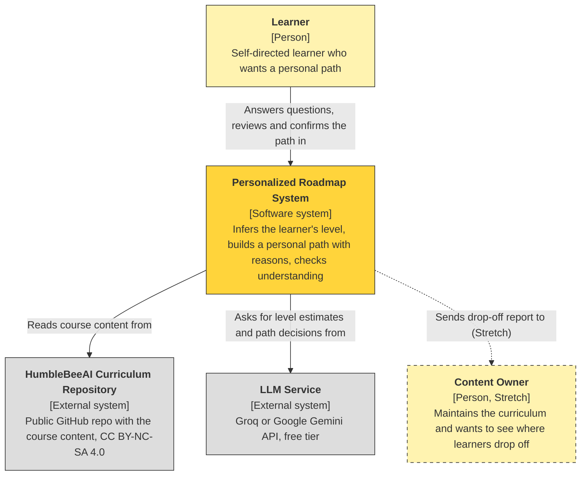
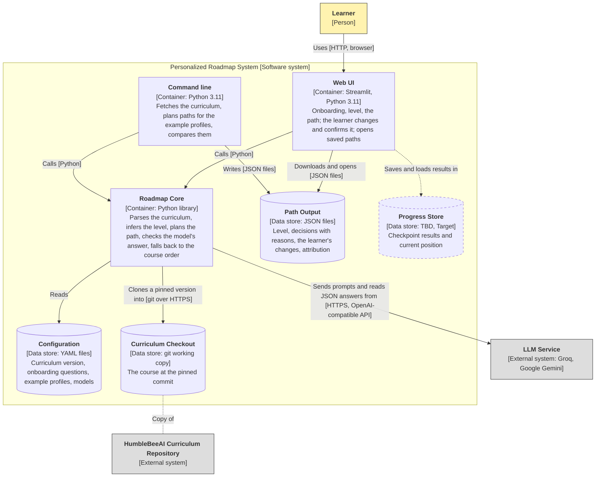

# Architecture: C4 Level 1 and Level 2

**Status:** updated for the midterm to the Baseline prototype in `src/roadmap/` and `app/`. The first draft was
submitted on 23 September; what changed since then is listed at the end. Things we have not decided are marked
**TBD**.

The diagrams are written in Mermaid, which GitHub draws automatically. **Dashed** boxes and arrows are Target or Stretch items, not Baseline.

We draw only Level 1 and Level 2, as the course guide asks.

---

## C1: System Context

**Question it answers:** who uses the system, what are we building, and what does it connect to outside itself?

**How to read it**

- The yellow box is what our team builds. Everything outside it is a person or an external system we do not control.
- The learner is the only user in Baseline. The content owner appears only in the Stretch item "drop-off analysis".
- We do **not** copy the curriculum into our repository. We read it from its own repository at a pinned version.
- Every arrow says what the connection is used for.

---

## C2: Container

**Question it answers:** what are the main applications and data stores inside the system, and how do they talk to each other?

The language model service is drawn **outside** the system boundary because we call it, we do not run it.

### What each container does

| Container | Responsibility | Technology | Tier |
|---|---|---|---|
| Web UI | Asks the onboarding questions, shows the suggested level with its evidence, shows the path; the learner changes any decision and confirms the path before downloading it; opens a saved path without calling a model | Streamlit, two pages (`app/`) | Baseline; the Target interface technology is TBD |
| Command line | Fetches the curriculum, plans a path for an example profile, compares the paths of all profiles | `python -m roadmap` | Baseline |
| Roadmap Core | Turns the curriculum into modules; infers the level and explains why; asks the model to decide study, prove or skip for every module with a reason; rejects an answer that leaves a module out and tries the next model; keeps the course order; falls back to the whole course when no model answers | Python library (`src/roadmap/`) | Baseline |
| Configuration | The pinned curriculum commit, the six onboarding questions, the three invented example profiles, the providers and models in fallback order | YAML files (`config/`) | Baseline |
| Curriculum Checkout | The course at the pinned commit, read directly from its Docusaurus files | Git working copy in `data/curriculum/`, git-ignored | Baseline |
| Path Output | The path: level and evidence, each module's suggested and chosen decision with the reason, confirmation time, attribution. Any interface only needs to read it | JSON files | Baseline |
| Progress Store | Remembers checkpoint results and where the learner is in the path | TBD (local file, SQLite or browser storage) | Target |

### Key decisions

1. **One Python process, no service.** The web interface calls the core directly. Baseline needs no HTTP API and no database; we add them only when the Target needs them. This matches the "Basic Python module" starter template we chose.
2. **The path JSON is the contract** between the core and any interface.
3. **The model judges, code decides the rest.** The model suggests the level and a decision for each module. Code keeps the course order, checks that every module got a decision, and attaches attribution, so these parts are tested and still work without a model.
4. **The learner has the last word.** Every decision the model suggests can be changed, and the path is confirmed before it can be downloaded.
5. **The curriculum stays outside our repository.** We clone it at a pinned commit and record the licence.

### Changes since the first draft

- **No prerequisite graph.** The path follows the course's own order. The curriculum already orders its modules and states its prerequisites as text, and a hand-written graph would need maintenance every time the course changes. The trade-off: we cannot reorder modules for a learner, only include, prove or skip them.
- **A web interface in Baseline.** We planned a command line for Baseline and a web interface for Target. Streamlit gave a usable interface for the same effort, and a demo is easier to follow in a browser. The command line stays for comparisons between profiles.
- **"Prove" as a third decision.** Besides study and skip, the model can suggest that the learner proves a module they likely know, using the module's own checklist. In Target, checkpoints will turn this into a real test.
- **The model is chosen.** Groq (`openai/gpt-oss-120b`) and Google Gemini through the same OpenAI-compatible client; see Q-003 for limits and measurements.

### Open points (TBD)

- Which provider is the default (Q-003).
- The interface technology for Target, and where progress is stored.
- Whether hosting is Hugging Face Spaces or something else (free tier only).

### Not shown on purpose

The modules inside the core (parser, level inference, planner, model client) belong to Level 3. We will draw them if the review needs them.
